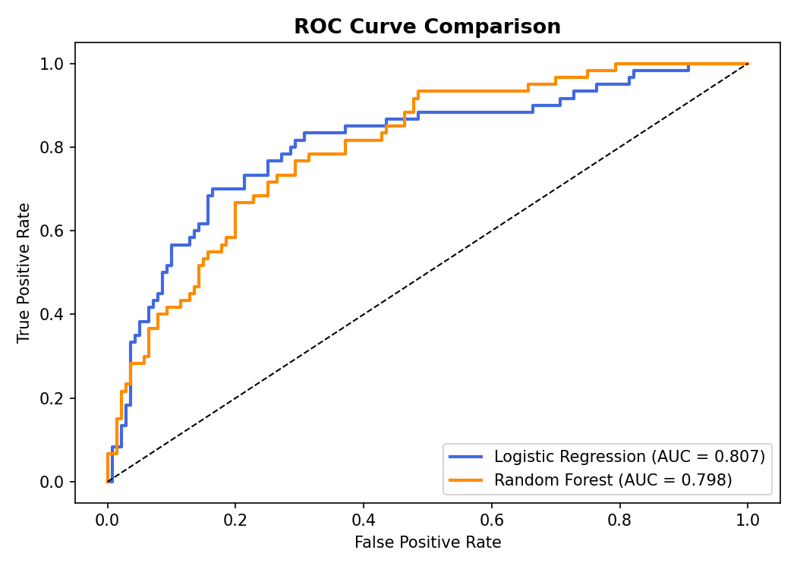
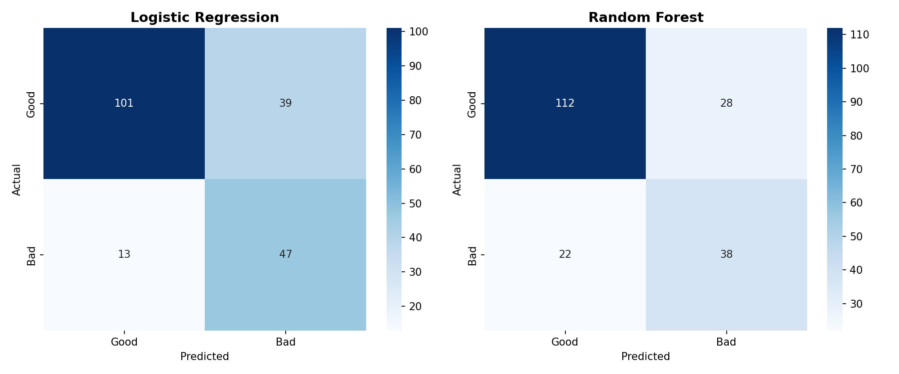
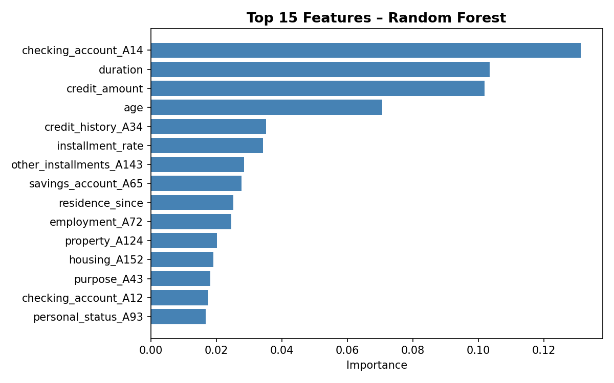

# Credit Risk Classification

Predicting if a loan applicant is a good or bad credit risk using the German Credit dataset. Full pipeline — data cleaning, EDA, model training and evaluation.

---

## Objective

Given a bank applicant's financial info, can we predict if they will default on a loan? The tricky part is that approving a bad applicant costs more than rejecting a good one, so the model has to be evaluated with that in mind.

---

## Dataset

- **Source:** [UCI Machine Learning Repository – Statlog (German Credit Data)](https://archive.ics.uci.edu/ml/datasets/statlog+(german+credit+data))
- **Records:** 1,000 applicants
- **Features:** 20 — account status, loan duration, credit history, employment, age, etc.
- **Target:** Good risk = 0, Bad risk = 1
- **Class split:** 70% good, 30% bad

> Dataset not included. Download `german.data` from the UCI link and put it in `data/`.

---

## Project Structure

```
credit-risk-project/
├── data/                   # dataset goes here (not tracked)
├── assets/                 # plots for README
├── notebooks/
│   └── eda.ipynb
├── src/
│   ├── preprocess.py
│   ├── train.py
│   └── evaluate.py
├── README.md
└── requirements.txt
```

---

## Methodology

1. One-hot encode categoricals, scale numericals, stratified 80/20 split
2. Used `class_weight='balanced'` to deal with the class imbalance — simpler than oversampling
3. Trained **Logistic Regression** as baseline (easy to interpret, good for regulated environments)
4. Trained **Random Forest** as second model (better performance, gives feature importances)
5. Evaluated both with ROC AUC, precision, recall, F1 and confusion matrix

---

## Results

| Model               | ROC AUC | Precision (Bad) | Recall (Bad) | F1 (Bad) |
|---------------------|---------|-----------------|--------------|----------|
| Logistic Regression | ~0.77   | ~0.62           | ~0.68        | ~0.65    |
| Random Forest       | ~0.80   | ~0.65           | ~0.65        | ~0.65    |

### ROC Curves



### Confusion Matrices



### Feature Importance (Random Forest)



---

## Business Interpretation

The most important metric here is **recall on the bad class**. Missing a bad applicant means approving a loan that will probably default, which costs the bank money. Random Forest has better AUC but Logistic Regression is easier to explain — you can directly look at the coefficients and understand which features are pushing the risk up or down. In a real banking setting that matters a lot for compliance.

One thing I would improve is tuning the decision threshold. Right now both models use 0.5 by default, but lowering that would catch more bad applicants at the cost of rejecting some good ones — which is usually the right trade-off for credit risk.

---

## How to Run

```bash
pip install -r requirements.txt

# run from inside src/
cd src
python train.py
python evaluate.py
```

---

## Next Steps

- Tune the decision threshold with a cost matrix
- Try XGBoost and see if it improves recall
- Add SHAP values to explain individual predictions

---

## Stack

Python · scikit-learn · pandas · matplotlib · seaborn
